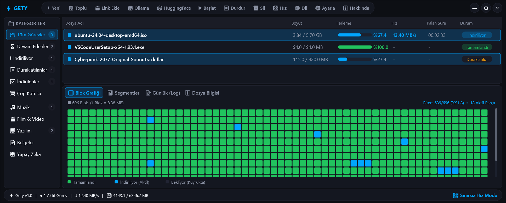
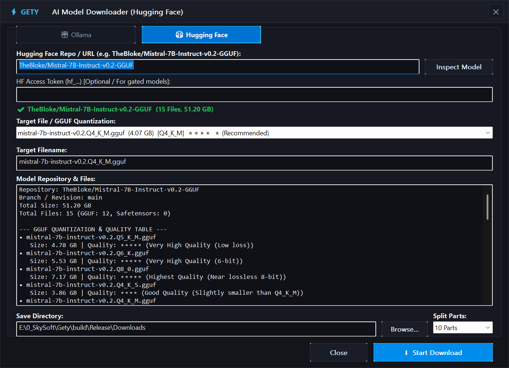
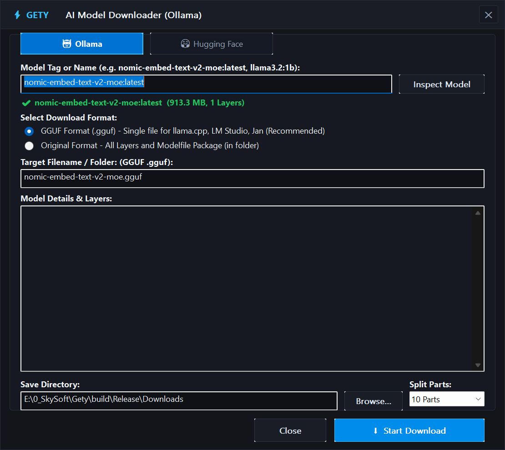

# ⚡ Gety - Ultra-Fast C++23 Native Download Manager & AI Model Downloader

<p align="center">
  
</p>

<p align="center">
  <a href="LICENSE"></a>
  
  
  
  
  
</p>

**Gety** is a high-performance, lightweight Windows download manager written in pure **C++23** with native **Win32** and **Direct2D** graphics. Designed for maximum speed and zero bloat, Gety features a multi-threaded segmented download engine, deep integration for downloading AI models (**Ollama** and **Hugging Face**), media extraction, a floating desktop drop target, and military-grade DPAPI AES-256 encrypted task persistence.

---

## 🌟 Key Highlights

- **Pure Native C++23 & Win32**: No Electron, no Qt, no bloated web views. Executable is self-contained (~1.7 MB) and statically linked (`/MT`). Idle RAM usage is only ~8–15 MB.
- **1 to 30 Segmented Download Engine**: Dynamically splits files across multiple concurrent HTTP/HTTPS connections (`HTTP/1.1 206 Partial Content`).
- **Zero-Wait Pre-Allocation**: Files are pre-allocated on disk (`SetEndOfFile`). Chunks write directly to designated offsets with overlapped asynchronous I/O. When the last byte completes, your file is immediately ready without merge delays.
- **Native AI Model Downloader**:
  - 🤖 **Ollama Registry Support**: Download LLM weights directly by model name (e.g. `llama3:8b`, `deepseek-r1:8b`, `nomic-embed-text-v2-moe:latest`) in raw blob or single GGUF formats.
  - 🤗 **Hugging Face Hub Support**: Fetch any repository or model (e.g. `unsloth/DeepSeek-R1-Distill-Qwen-7B-GGUF`), resolve direct Cloudflare/S3 CDN endpoints, filter files, authenticate private/gated models with Bearer tokens, and leverage smart GGUF quantization scoring.
- **Direct2D Visual Download Matrix**: Real-time hardware-accelerated grid displaying active, completed, and pending byte ranges with zero latency.
- **Floating Desktop Drop Zone**: Semi-transparent HUD overlay that floats over games or browser windows, accepting drag-and-drop links with live throughput telemetry.
- **Crash-Resilient Encrypted Task Storage (`v5`)**: Atomic temp-and-swap DPAPI AES-256 `tasks.json` persistence with automatic `.bak` failover, 64-bit exact per-segment byte offsets, periodic auto-save, disk reconciliation, and graceful Windows shutdown hooks (`WM_QUERYENDSESSION` / `WM_ENDSESSION`).
- **Seamless Windows Auto-Start**: Optional one-click startup in background tray (`--minimized`) from Options or the System Tray menu, with automatic portable path self-healing if `Gety.exe` is moved.
- **Commercial Friendly**: Released under the permissive **MIT License**.

---

## 📸 Screenshots

### 1. Main Dashboard & Visual Matrix
Hardware-accelerated Direct2D segmented progress grid, transfer telemetry, category tree, and floating HUD target.


### 2. Hugging Face AI Model Downloader
Search and browse Hugging Face repositories, inspect file trees, filter GGUF quantizations with automated star ratings (⭐ 1-5), and download directly via accelerated CDNs.


### 3. Ollama AI Model Downloader
Download Ollama models seamlessly with tag resolution, manifest exploration, and layer extraction.


---

## 🧠 AI Model Hub Features

Gety brings AI model acquisition directly into a fast, multi-threaded native download manager:

### 🤗 Hugging Face Integration
- **Model Resolution**: Enter any Hugging Face repo ID (`owner/model-name`) or branch.
- **Smart GGUF Quantization Scoring**: Automatically evaluates quantization formats (`Q4_K_M`, `Q5_K_M`, `Q8_0`, `IQ4_XS`, etc.) and assigns a **1 to 5 Star Rating** to recommend the optimal quality-to-VRAM ratio.
- **Direct CDN Redirection**: Bypasses rate limits and redirects directly to high-throughput Cloudflare / CloudFront / S3 edge endpoints.
- **Private & Gated Models**: Supply personal Hugging Face tokens (`hf_...`) to access gated models (like Llama 3, Gemma, etc.).

### 🤖 Ollama Hub Integration
- **Direct Manifest Fetching**: Communicates with the Ollama Docker Registry API (`registry.ollama.ai`) using native WinHTTP and Windows Schannel TLS.
- **Format Flexibility**: Download models as individual Ollama layers or package them into standalone `.gguf` files for direct use with `llama.cpp`, `KoboldCPP`, or `LM Studio`.

---

## ⚡ Technical Architecture

| Component | Implementation Details |
| :--- | :--- |
| **Language & Standard** | ISO C++23 (`/std:c++latest`, `/permissive-`, `/Zc:__cplusplus`, MSVC 2022) |
| **GUI Framework** | Native Win32 API, Custom Dark Theme, Direct2D & DirectWrite |
| **Network Stack** | Microsoft WinHTTP with HTTP/2 & HTTP/3 negotiation + Windows Schannel (TLS 1.2 / 1.3) |
| **File I/O** | Win32 Asynchronous Overlapped I/O, Pre-allocation (`SetEndOfFile`), Atomic `MoveFileExW` |
| **Concurrency** | Deterministic `std::thread` joins, `std::recursive_mutex`, lock-free atomics |
| **Security & Cryptography**| Windows Crypt32 DPAPI (AES-256) with portable fallback |
| **Persistence** | Crash-safe atomic `v5` JSON (`portable_data/tasks.json` + `.bak` failover) & disk reconciliation |
| **System Integration** | Windows Startup (`HKCU\...\Run` `--minimized`), `WM_COPYDATA` single-instance IPC, `WM_ENDSESSION` |
| **External Media** | Native integration with `yt-dlp` (`2026.10.26+`) & `ffmpeg` for video/audio stream extraction |

---

## 🚀 Recent Updates & Bug Fixes

### What's New in v1.1.0 — Persistence Overhaul, Windows Auto-Start & C++23 Upgrade
- **v5 Crash-Resilient State & Segment Persistence:** Upgraded `tasks.json` to schema `v5`, persisting exact 64-bit `totalBytes`, `downloadedBytes`, `supportsResume`, `resolvedUrl`, and full per-segment byte offsets (`segments` array) so multi-part and large (>4 GB) downloads never reset to `0%` or restart from byte `0` after closing Gety or rebooting Windows.
- **Atomic Saves, Auto-Backup & Windows Shutdown Hooks:** Replaced in-place file truncation with atomic `tasks.json.tmp` → `MoveFileExW` commits, automatic `tasks.json.bak` recovery on corruption, event-driven + 3-second periodic auto-saves, and Win32 `WM_QUERYENDSESSION` / `WM_ENDSESSION` handlers.
- **Smart Disk Reconciliation & UI Progress Accuracy:** Added startup disk reconciliation (`ReconcileWithDisk`) that automatically promotes already-finished `.mp4`/binary files on disk to `Completed`, recovers partial `.part` media byte counts, and ensures `Completed` tasks always render at `100.0%` even if the file is later moved externally.
- **Windows Startup (`--minimized`) & Tray Toggle:** Added strict CLI flag parsing (`CliArgs.h`) so `--minimized` / `--autostart` / `--tray` launches silently in the system tray without queuing flags as download URLs, added a **Start automatically with Windows** toggle directly to the System Tray right-click menu, and added automatic Registry path self-healing when portable `Gety.exe` is moved.
- **C++23, Windows 11 SDK & Modern WinHTTP Stack:** Upgraded build toolchain to **C++23**, centralized `WinHttpUtils::CreateSession()` with **HTTP/2 + HTTP/3** negotiation, **TLS 1.2 / 1.3**, automatic gzip/deflate decompression for Ollama & Hugging Face API clients, updated `yt-dlp` integration (`~` approximate size parsing, intermediate stream suffix handling), and expanded the test suite to **19 automated engine tests**.

### 1. Robust Download Pause & Worker Thread Management
- **Eliminated Unwanted Auto-Resume:** Fixed a critical race condition where terminating segment workers during pause reported simulated network dropouts, unintentionally triggering the engine's automatic reconnect/retry loop after a 2-second timeout.
- **Immediate Probe Cancellation:** Added atomic cancellation tracking (`m_pauseRequested`) and bound in-flight probe session/request handles (`m_hProbeSession`, `m_hProbeRequest`) so probing connections abort immediately upon user pause instead of launching background workers.
- **Thread Lifetime Safety:** Replaced uncoordinated thread detachment with deterministic `join()` operations and handle cleanup across all `SegmentWorker` instances, eliminating potential use-after-free exceptions and memory corruptions.
- **Unified State Coverage:** Pause now functions deterministically across all download states, including queued downloads, active multi-segment HTTP transfers, and external `yt-dlp` stream extraction processes.

### 2. Native In-Place Task & File Renaming (`F2` / Context Menu)
- **Keyboard & Menu Integration:** Added support for renaming tasks directly using the **F2** shortcut key or through the right-click context menu (✏ *Yeniden Adlandır / Rename*).
- **Physical Disk Synchronization:** Automatically pauses active transfers, synchronizes file changes on disk using Win32 `MoveFileW` (supporting both multi-part `.gety` temporary files and completed assets), updates task metadata and file paths, and seamlessly resumes downloading if it was running.
- **Custom Frameless Modal Dialog:** Designed a sleek, dark-themed frameless dialog featuring pre-selection of the filename stem (excluding the file extension for instant editing) and strict Win32 forbidden character sanitization (`\ / : * ? " < > |`).

### 3. Granular Deletion Controls (File Retention vs. Permanent Disk Purge)
- **Eliminated Accidental Data Loss:** Addressed the lack of disk file retention options during task removal. Task deletion no longer assumes arbitrary disk deletion behavior.
- **Dual-Action Context Menu:**
  - 🗑 **Remove from List (Keep File)**: Instantly clears the task entry and transfer statistics while strictly preserving the downloaded payload on disk.
  - ❌ **Delete File from Disk...**: Triggers deletion along with physical removal of all associated disk files and metadata.
- **Interactive Dark Confirmation Dialog:** Features an explicit confirmation popup with an unchecked-by-default checkbox (`[ ] İndirilen dosyayı da diskten kalıcı olarak sil` / `Permanently delete downloaded file from disk as well`), ensuring files remain safely on disk unless explicitly instructed otherwise.

---

## 🛠️ Building from Source

### Prerequisites
- **Operating System**: Windows 10 / 11 (x64)
- **Compiler**: Visual Studio 2022 (MSVC v143) with C++23 / Desktop Development with C++ workload
- **Build System**: CMake 3.20 or newer

### Build Steps

```powershell
# Clone the repository
git clone https://github.com/geataa/Gety.git
cd Gety

# Configure CMake with Visual Studio 2022 x64 generator
cmake -B build -G "Visual Studio 17 2022" -A x64

# Compile Release binary
cmake --build build --config Release
```

The compiled standalone executable will be generated at `build/Release/Gety.exe`.

### Running Automated Tests

Gety includes 19 automated engine tests (HTTP parsing, 64-bit JSON precision, v5 DPAPI state & `.bak` recovery, disk reconciliation, CLI/Registry autostart roundtrip, Ollama & Hugging Face live Hub resolution):

```powershell
cmake --build build --config Release --target test_engine
.\build\Release\test_engine.exe
```

---

## 🤝 Acknowledgements & References

Gety's native AI model download capabilities were inspired by and reference the logic of two outstanding open-source projects:

1. **[akx/ollama-dl](https://github.com/akx/ollama-dl)** by [@akx](https://github.com/akx)
   - *Inspiration*: Ollama model manifest parsing, Docker/OCI registry layer negotiation, and blob-to-GGUF mapping concepts.
2. **[bodaay/HuggingFaceModelDownloader](https://github.com/bodaay/HuggingFaceModelDownloader)** by [@bodaay](https://github.com/bodaay)
   - *Inspiration*: Hugging Face API file tree resolution, direct CDN header following, and GGUF quantization scoring strategies.

Both projects provided tremendous architectural inspiration, which we reimplemented as pure native C++23 modules with multi-threaded WinHTTP streaming. Special thanks to the authors!

---

## 🤖 Vibe Coding with Google DeepMind Gemini 4

This project embraces the future of software engineering: **Gety was originally forged with Gemini 3.8 and evolved to v1.1.0 (C++23) through Vibe Coding with Google DeepMind's Gemini 4 via Antigravity**.

- **Human Vision & Direction**: System architecture design, UX conception, performance specifications, and real-time validation by [@geataa](https://github.com/geataa).
- **AI Agentic Execution**: High-performance C++23 native code synthesis, Win32 message loop design, Direct2D rendering pipelines, crash-resilient DPAPI persistence, and security implementations powered by **Gemini 4** (building on its **Gemini 3.8** foundations).
- **Zero Hallucination Standard**: 100% verified with deterministic automated test suites and live execution benchmarks.

We believe in radical transparency: AI-assisted development empowers solo creators to deliver robust, industrial-grade native applications at breakneck speed.

---

## 🎮 Also From SkySoft / geataa on Steam

> By day, I work full-time as a software engineer. Evenings and weekends are dedicated to my passion for indie game development. In the spare moments left over from crafting games, I build tailored, high-performance native tools like Gety through modern **vibe coding** with AI.
> 
> When I'm not writing native tools, check out the game worlds I'm bringing to life on Steam:

<div align="center">

### 🧗 [BouncyClimb](https://store.steampowered.com/app/4787630/)
*A high-octane, physics-defying multiplayer climbing and platforming adventure! Race against your friends, scale hazardous heights, and master the bounce.*

[](https://store.steampowered.com/app/4787630/)

---

### 🍸 [Neon Angora](https://store.steampowered.com/app/4447940/)
*A groundbreaking social simulation and nightclub roleplaying experience powered by Local LLM AI. No canned dialogue trees—speak your mind, influence dynamic NPCs, uncover secrets, and experience a living story that reacts to who you choose to be.*

[](https://store.steampowered.com/app/4447940/)

</div>

---

## 📄 License

Gety is licensed under the **[MIT License](LICENSE)**. 

You are free to use, modify, distribute, and incorporate Gety into private and **commercial** projects with virtually no restrictions.

---

<p align="center">
  Crafted with ❤️, C++23, and Vibe Coding by <b>SkySoft / geataa</b>.
</p>
